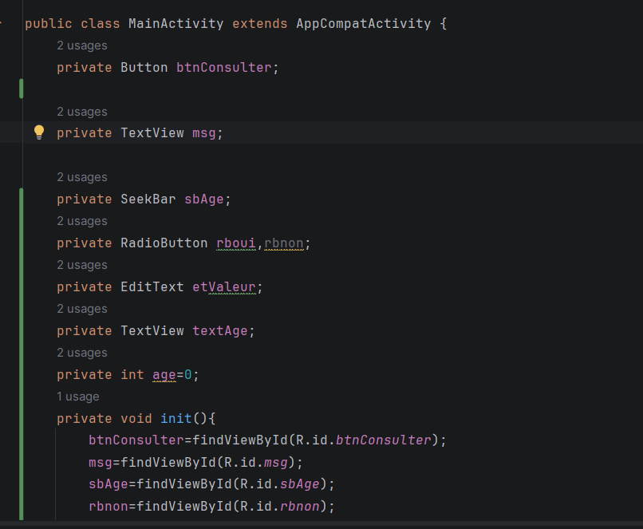
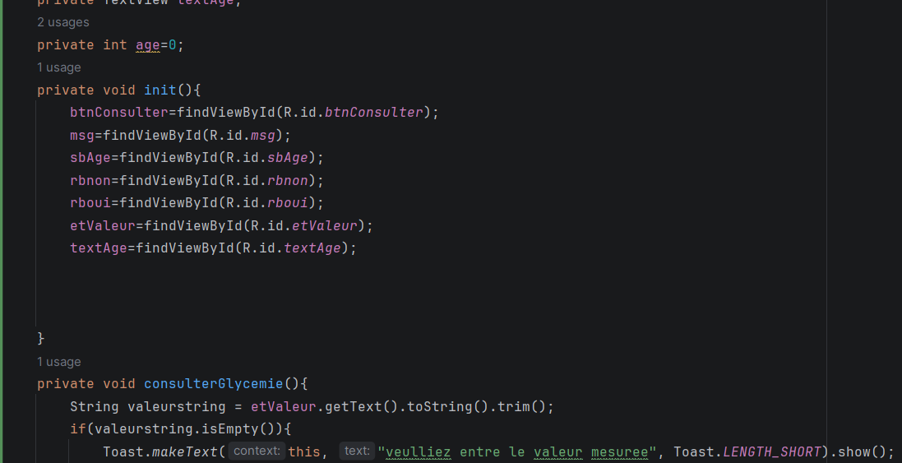
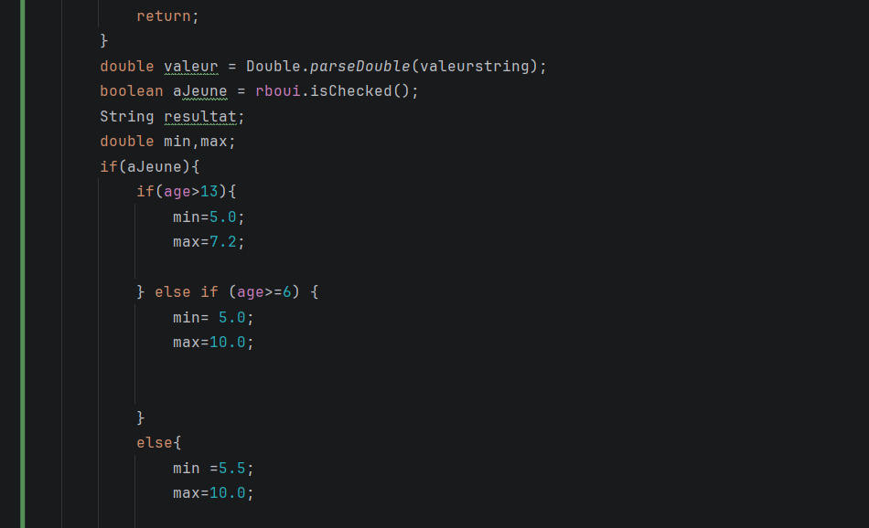
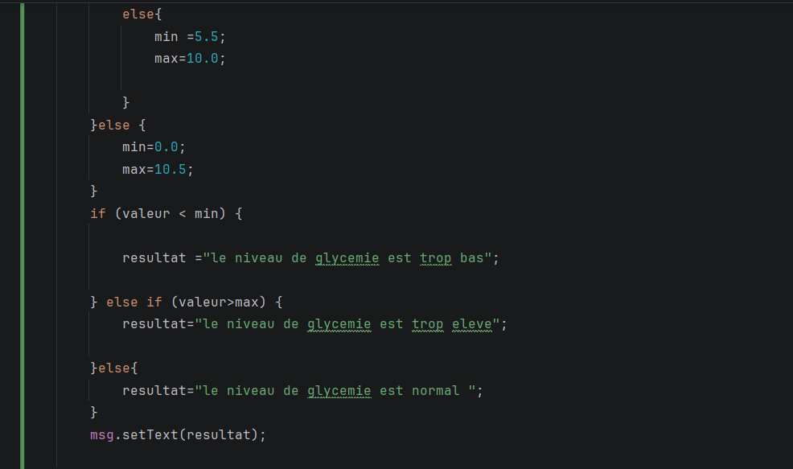
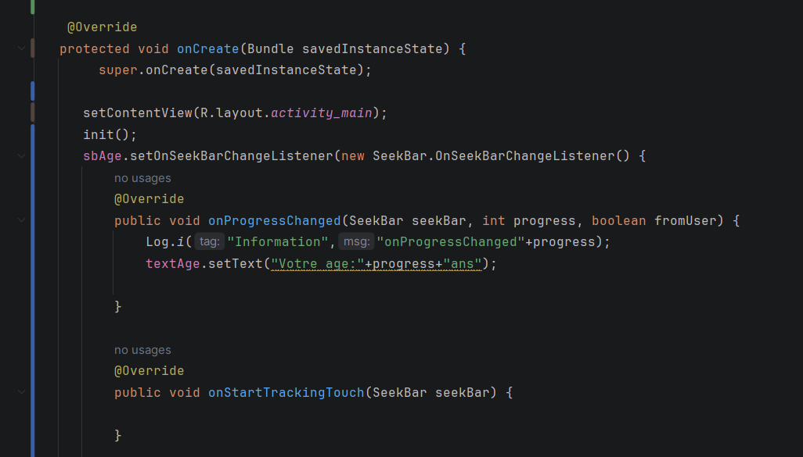
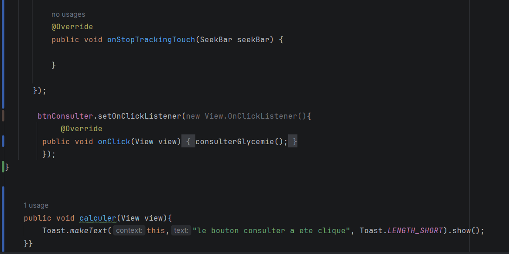
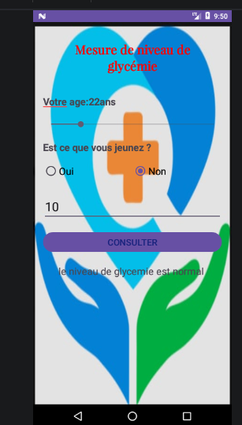

# Mesure de niveau de glycémie

Application Android développée en Java dans le cadre du projet LSI3. Elle permet de saisir l’âge, l’état de jeûne et une valeur mesurée, puis de lancer une consultation afin d’afficher un message de résultat.

> Prototype pédagogique : cette application sert à illustrer la conception d’une interface Android et la logique de base du bouton de consultation. Elle ne remplace pas un avis médical ni un dispositif de diagnostic réel.

## Objectif du projet

L’application a pour but de mettre en pratique les notions de :

- création d’une interface Android avec XML,
- gestion des composants UI (SeekBar, RadioButton, EditText, Button),
- traitement des événements Java,
- affichage d’un résultat dynamique dans une TextView.

## Fonctionnalités

- Sélection de l’âge à l’aide d’un curseur (0 à 120 ans),
- choix du statut de jeûne : oui / non,
- saisie d’une valeur en mmol/L,
- validation via le bouton CONSULTER,
- affichage d’un message selon la valeur saisie.

## Captures d’écran

### Écran principal de l’application

### Saisie et consultation

### Autres captures du projet

## Structure du projet

- `app/src/main/java/com/example/bouaziz_islem_lsi3_mesure_glycemie/MainActivity.java` : logique Java de l’application,
- `app/src/main/res/layout/activity_main.xml` : interface utilisateur,
- `app/src/main/res/values/strings.xml` : ressources de l’application,
- `capture/` : captures d’écran du projet.

## Exécution

1. Ouvrir le projet dans Android Studio.
2. Synchroniser les dépendances Gradle.
3. Sélectionner un émulateur ou un appareil Android.
4. Lancer l’application avec le bouton Run.

## Remarque importante

Cette application est conçue à des fins pédagogiques dans le cadre d’un travail universitaire. Elle ne doit pas être utilisée pour surveiller ou interpréter un niveau réel de glycémie dans un contexte médical.

